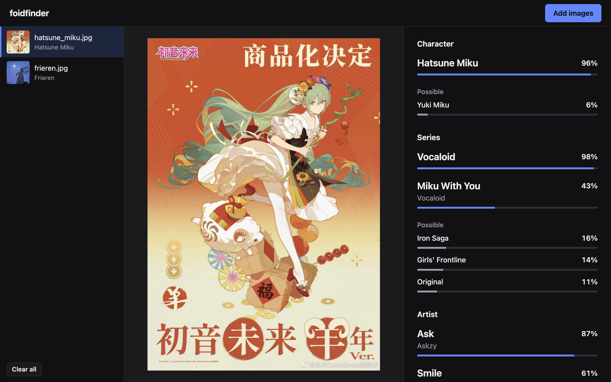
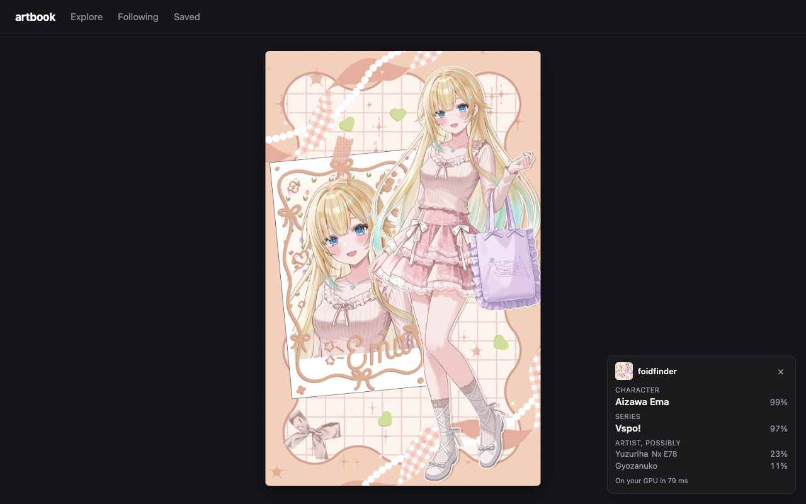

# foidfinder

foidfinder identifies the characters, series, artists, and tags in anime images directly in the browser using WebGPU.

Currently ships with [Haruka Tagger](https://huggingface.co/KaraKaraWitch/haruka-tagger) (EVA02-B/14 at 448 px, 18-query tree head, 98,782 tags including 38,447 artists) using a compressed 187 MB checkpoint ([alpindale/haruka-compressed](https://huggingface.co/alpindale/haruka-compressed)) reconstructed on the GPU.



## Development

Requires Node.js 22+ and a browser with WebGPU and `shader-f16` (recent Chrome, Edge, or Safari).

```sh
npm ci
npm run dev              # start the web UI dev server
npm run lint             # ESLint + TypeScript checks across all workspaces
npm test                 # Vitest unit tests across all workspaces
npm run build            # build both apps/web/dist and apps/extension/dist
```

To point the web UI at a custom model host, set `VITE_MODEL_BASE` at build time and allow that origin in `connect-src`.

## Hosting the web UI

The web UI compiles to static files in `apps/web/dist/`:

```sh
npm ci
npm run build:web
```

Serve `apps/web/dist/` over HTTPS (WebGPU and the Cache API require a secure context). `deploy/Caddyfile` serves it with a CSP whose `connect-src` allows model downloads from Hugging Face.

## Browser extension

The extension adds **Identify with foidfinder** to the image context menu in Chromium browsers (Chrome/Edge 121+ with WebGPU `shader-f16`) and renders results in a closed Shadow DOM card on the page.



```sh
npm run build:extension  # writes apps/extension/dist/
```

Open `chrome://extensions`, turn on **Developer mode**, choose **Load unpacked**, and select `apps/extension/dist`.

On first use the model downloads into the extension's Cache API storage (~178 MB), runs in a hidden offscreen document Web Worker, and unloads after 5 idle minutes.

By default the extension only accesses the active tab when invoked (`activeTab`). Its options page lets users grant optional `<all_urls>` access for full-quality downloads from hotlink-protected or cross-origin hosts (falling back to in-page reads and visible-tab screenshot crops otherwise).

| Permission | Used for |
|---|---|
| `activeTab` | Active tab when the menu item is clicked: displaying the card, reading the image, screenshot fallback |
| `<all_urls>` (optional) | Full-quality downloads from any host when enabled in settings |
| `scripting` | Injecting the result card script on demand |
| `offscreen` | Hidden document hosting the WebGPU Web Worker |
| `declarativeNetRequestWithHostAccess` | Setting the page origin as `Referer` for extension image downloads |
| `unlimitedStorage` | Caching the model checkpoint |
| `contextMenus` | Adding the right-click menu entry |

## License

Apache-2.0.
